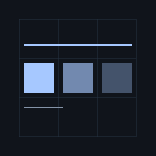

<div align="center">



# sd-widgets

**A Steam Deck control surface and a PC companion daemon**

[Русская версия](./README.ru.md)

<br>

</div>

A **Steam Deck control surface** plus a **PC companion daemon**. It turns the Deck
into a second screen, a virtual gamepad, a notification panel and a Home Assistant
remote — and it looks like a hard-edged, 32 px grid system instead of a phone app.

- **One repo, two binaries**: `sdw-deck` (runs on the Deck) and `sdw-daemon` (runs on the computer).
- **Grid** visual language: no rounding anywhere, hairline borders, 32 px cells,
  and a minimal set of **Material Symbols** icons.
  The grid look is inspired by [**Quadra**](https://quadrahq.org), the Roblox
  client for Linux. It is a wonderfully crafted piece of software — hard-edged,
  quiet and exact — and we are happy to point at it. Go give it a look.
- **Full customisation**: CSS themes, an exact 15-token palette editor, density,
  tile grid, page and tile visibility, interface sounds, per-event sound files.
- **A clock you own**: a big grid face plus digital, analog and minimal styles,
  with font, size, animation, position, 12/24-hour time, caption, headset battery
  and the latest notification. It takes its colours from the active theme, so
  every preset, palette and CSS file repaints it; custom colours are one switch
  away.
- **Addons on both sides**: declarative packages add themes, clock presets, home
  tiles, sounds and daemon actions without rebuilding anything.
- **PC audio on the Deck**: stream the whole computer or picked applications to
  the Deck speakers, with a configurable number of “are you sure?” steps.
- **Self-updates**: both applications check the newest release on
  `git.entitybtw.ru`, show the notes and download the matching build.
- **Bilingual**: English and Russian, dark and light.

> The product name is lowercase: `sd-widgets`.

## What it does

### On the Steam Deck (`sdw-deck`)

| Page | What it is |
| --- | --- |
| **Home** | A grid of large touch tiles: gamepad, screen, notifications, Home Assistant, binds, computers. |
| **Computers** | LAN discovery, pairing by password, switching between several computers. |
| **Gamepad** | A drawn Steam Deck with every control, live highlighting, and a bind editor for any control or gesture. |
| **Screen** | The extra monitor stream: start/stop, backend, position, resolution, fps, quality, input forwarding. |
| **Audio** | The computer's sound, or picked applications, through the Deck speakers; source, quality, volume and confirmations. |
| **Notifications** | Mirrored desktop notifications, newest first, unread counters. |
| **Home Assistant** | Rooms and areas with lights, curtains, climate and media widgets, not a wall of every entity. |
| **Binds** | Buttons, chords and swipe gestures mapped to actions or remote commands. |
| **Clock** | A full-screen clock in four styles, each fully configurable and saved as a preset or an addon. |
| **Addons** | Import, enable, configure and remove packages; save the current look or clock as one. |
| **Look** | Presets, palette, CSS editor, grid, density, dock/arrows, page visibility, sounds. |
| **Settings** | Device name, language, theme, UI scale, input devices, updates. |

Every page can be reached by the **visible left/right arrows**, by the floating
glyph dock, by three-finger swipes, by keyboard, or with the deck's own controls:
the left stick and d-pad move a cursor, the right stick scrolls, **A** clicks,
**B** goes back, **LB/RB** change pages, **Y** opens Home and **View** opens
Settings. Drag anywhere on a page to scroll; a horizontal swipe from a screen
edge also switches pages. While you swipe, the page follows your finger; on
release it either eases back or slides into the next space with a fade and a
directional slide, and the tiles stagger in behind it.

### On the computer (`sdw-daemon`)

- **Virtual gamepads via VIIPER** — Xbox 360, DualShock 4, DualSense and generic
  pads, hot-plugged over USBIP. VIIPER can be installed from the GUI.
- **Extra monitor** — creates a real additional monitor and streams it to the Deck:
  - Hyprland: headless output (`hyprctl output create headless`).
  - niri: VKMS output + `niri msg output` (niri has no native virtual outputs);
    one button in the wizard loads VKMS and keeps it loaded after a reboot.
  - KDE: `krfb-virtualmonitor` with a built-in RFB client.
  - X11 and Windows: `ffmpeg` desktop capture.
  - macOS: `screencapture`.
  - virtual machines: the same VKMS path is picked automatically, with a
    readiness row for the kernel module, the output and the config.
  - Fallback: mirror an existing output with `grim`/`spectacle`.
- **Automatic layout** — choose right/left/above/below/auto in the daemon and the
  layout is applied live and written into the compositor config
  (`~/.config/niri/config.kdl`, `~/.config/hypr/hyprland.conf`,
  `~/.config/sway/config`, KDE screen config, X11 `xrandr`).
- **Notification mirroring** — watches the desktop notification bus and serves the
  stream to the Deck.
- **Home Assistant** — URL + long-lived token, entities proxied through the daemon
  so the token never lives on the Deck.
- **PC audio** — records the default output or the applications you pick and
  serves raw PCM to the Deck, which plays it with `pw-play`/`paplay`. The daemon
  keeps it off until you allow audio, and the Deck can require any number of
  confirmations before a stream starts.
- **Always in the background** — closing the window does not stop the daemon:
  it hides (or minimizes on Wayland) while the API and the Deck connection keep
  running. The tray icon, `sdw-daemon --show` or simply starting the daemon
  again brings the window back, and `sdw-daemon --quit` (or the tray menu, or a
  second close press) stops it for real.
- **Setup wizard** — password inputs, dependency detection, install buttons for
  VIIPER and friends, and an explicit line telling you what to add to your
  compositor config when auto-patching is not possible.

## Requirements

**Deck side**

- Linux (SteamOS, CachyOS handheld, any distro), Wayland or X11.
- `input` group membership for the deck's own controls and gestures. Touch and
  the on-screen UI still work without it; Home shows the exact command to run.
- Build: Rust 1.88+.

**Computer side**

- Linux, Windows or macOS.
- Optional at runtime, depending on features:
  - VIIPER 0.6+ for virtual gamepads (the daemon can install it).
  - `usbip` for VIIPER local attach.
  - `hyprctl` / `niri` / `krfb-virtualmonitor` / `ffmpeg` / `grim` / `spectacle` /
    `xrandr`, depending on the monitor backend.
  - `pw-play`, `paplay`, `aplay`, `ffplay` or `mpv` on the Deck for interface sounds.

## Install

### Steam Deck — one command

Open **Desktop Mode → Konsole** and run:

```bash
curl -fsSL https://git.entitybtw.ru/entitybtw/sd-widgets/raw/branch/main/packaging/install.sh | bash -s -- deck
```

It installs `~/.local/bin/sdw-deck`, adds the menu entry and puts **sd-widgets**
into the Steam library with artwork, so it starts from Game Mode. Steam keeps the
library in memory, so the script restarts it once to save the new shortcut.

### Computer — one command

```bash
curl -fsSL https://git.entitybtw.ru/entitybtw/sd-widgets/raw/branch/main/packaging/install.sh | bash -s -- daemon
```

It installs `~/.local/bin/sdw-daemon`, enables a systemd user service and starts
it. Open `http://<computer>:47830` once to finish the setup, then pair the Deck.

Both installers take `--version V` to pin a release, `--local FILE` for an
AppImage you already downloaded, `--dir DIR` to change the prefix, plus
`--no-service`, `--no-steam`, `--no-steam-restart` and `--steam-only`. They are
idempotent: rerunning updates the files and the existing Steam entry instead of
adding a second one. Details: [`docs/INSTALL.md`](docs/INSTALL.md).

### Prebuilt

Grab the artifacts from the releases page:

- `sdw-deck-<version>-x86_64.AppImage` — Steam Deck / Linux.
- `sdw-daemon-<version>-windows-x86_64.zip` — Windows.
- `sdw-daemon-<version>-macos-<arch>.dmg` — macOS.

### From source

```bash
git clone https://git.entitybtw.ru/entitybtw/sd-widgets
cd sd-widgets
cargo build --release -p sdw-deck -p sdw-daemon
```

Binaries land in `target/release/`.

## Updates

Both applications check the newest published release on
`https://git.entitybtw.ru/entitybtw/sd-widgets/releases` when they start and every
six hours after that. **Settings → Updates** shows the version, the release notes
and a download button. On Linux the downloaded AppImage replaces the running binary
(the restart is yours); on Windows and macOS the downloaded file is shown so you can
swap it in. Headless users can do the same without a window:

```bash
sdw-daemon --check-updates
sdw-daemon --download-update
```

## Pairing

1. Start `sdw-daemon` on the computer. The first launch opens the setup wizard and
   shows a **pairing password**.
2. Start `sdw-deck` on the Deck, open **Computers → add computer**, pick the daemon
   from LAN discovery or type its address.
3. Enter the password once. The daemon returns an API token; the Deck stores it per
   host and never needs the password again.
4. Switch computers at any time from the header or the Computers page.

The daemon listens on `47830/tcp` (REST), `47831/udp` (gamepad input) and
`47832/udp` (LAN discovery). All REST calls require the bearer token.

## Extra monitor

The daemon creates a monitor that really exists for the operating system, then
streams it to the Deck at 1280×800 by default.

- Choose **position** in the daemon: auto, right, left, above, below.
- Choose the backend, size, fps and JPEG quality.
- The daemon applies the layout immediately and persists it into your compositor
  config.
- On niri, sway, GNOME and inside a virtual machine it creates a VKMS output and
  offers a single **prepare vkms** button that loads the module and writes the
  `modules-load.d`/`modprobe.d` files. The wizard also shows a readiness row:
  module in the kernel, module loaded, output found, config path.
- If a compositor cannot be patched automatically, the wizard prints the exact line
  to add.

Details and per-compositor notes: [`docs/MONITOR.md`](docs/MONITOR.md).

## Themes, layout and sounds

The **Look** page is the whole design system:

- five presets: Grid, Monochrome, Nord, Gruvbox, Terminal;
- exact colour pickers for all 15 tokens in both palettes: `bg`, `bg2`, `card`,
  `well`, `ink`, `strong`, `muted`, `faint`, `line`, `line-strong`, `accent`,
  `accent-soft`, `good`, `warn`, `bad`;
- a live CSS editor — any `--name: value;` declaration is picked up;
- grid on/off, cell size and line opacity;
- density, font scale, tile height and column count;
- arrows, dock, labels, glyphs and animations;
- which pages appear in the dock and which tiles appear on Home;
- three synthesized sound packs (`grid`, `soft`, `chip`), volume, and a custom
  WAV path for every event.

The CSS variables and the full theme model are documented in
[`docs/THEMES.md`](docs/THEMES.md).

## Clock

The Clock page draws a full-screen clock and keeps the settings next to it:

- four faces: **grid** (the big time on the house grid), **digital**, **analog**
  and **minimal**;
- accent and two background colours, a font choice, size, animation (`drift`,
  `pulse`, `off`), screen position and a caption;
- optional seconds, date, weekday, deck battery, headset battery and a one-line
  notification summary;
- 12/24-hour time and a full-screen mode that exits on a tap or Escape;

Any configuration can be saved as a clock addon and then reused or shipped.

## PC audio

The **Audio** page turns the Deck into a speaker for the computer:

- **whole computer** or **picked applications** — several at once, each recorded
  separately on PipeWire and mixed in the daemon; on plain PulseAudio a
  temporary sink is used and streams are returned on stop;
- 44.1 or 48 kHz stereo PCM over the authenticated LAN connection, played by
  `pw-play` (or `paplay`/`aplay`);
- source list, transfer size, time and clear errors on both sides;
- a **confirmations** setting (0–3) that asks “are you sure you want to move the
  sound to the deck?” that many times before streaming.

Audio is off in the daemon until **Audio → allow audio** is on, and
**start from the deck** can be disabled so only the computer can start a stream.
Details: [`docs/AUDIO.md`](docs/AUDIO.md).

## Addons

An addon is a folder with `addon.json` and its assets, a single `.css` /
`.json` / `.sdwaddon` file, or a link to any of those. Packages unpack zips
themselves, so there is no `unzip` to install. One package can extend both
sides:

- a **theme** CSS and extra CSS;
- a **clock preset** JSON;
- **home tiles** on the deck;
- **sound cues** that replace the built-in files;
- **daemon actions** exposed to the deck as `addon:<id>:<action>` and runnable
  from both the deck and the daemon GUI;
- typed **settings** (`text`, `number`, `bool`, `color`, `choice`) rendered by
  both applications, with `{key}` filled into every action at run time.

### Store

**Addons → store** takes a link to a repository and lists its packages as
tiles with one **install** button. A store is a static JSON catalogue
(`repo.json`, `index.json`, `api/v1/addons.json` or `addons.json`) plus the
packages it points at; relative links resolve against the repository base and
an optional `sha256` is verified before install. The deck installs the package
locally and asks the paired computer to install the same link, so a package
with daemon actions works on both sides after one press.

### HTTP actions

An addon action can call any API:

```json
{ "http": { "method": "POST", "url": "{base}/hooks/{token}",
            "body": "{\"entity\":\"{settings.entity}\"}" } }
```

The request runs in the background on both sides, has a 20 s timeout, and its
answer becomes a short toast or log line. Only `http`/`https` addresses are
accepted.

Install from **Addons → import** on the deck or in the daemon window. The exact
format, every field, the catalogue schema and the security model are in
[`docs/ADDONS.md`](docs/ADDONS.md).

## API

The Deck and the daemon speak JSON over HTTP. See [`docs/API.md`](docs/API.md) for
the endpoints: pairing, status, gamepad, notifications, Home Assistant, monitor,
remote commands and discovery.

Remote PC commands are a **fixed whitelist** (`suspend`, `lock`, `volume`, media
keys, opening URLs). There is no arbitrary shell endpoint.

## Repository layout

```
crates/sdw-core      shared model, REST client, auth, discovery, UDP, i18n
crates/sdw-deck      the Deck app (egui)
crates/sdw-daemon    the PC daemon, server and GUI (egui)
vendor/viiper-client vendored MIT Rust client for VIIPER
assets               fonts and icons
packaging            install.sh, desktop files, systemd unit, AppImage / Windows / macOS scripts
docs                 architecture, API, themes, monitor notes, addons, audio
```

## Security

- Passwords are stored as SHA-256 hashes with a random salt; the derived API token
  is random per daemon and per pairing.
- The REST server binds to the LAN and requires the token on every route.
- The extra monitor only ever exposes the monitor the daemon created (or the
  selected output in mirror mode).
- Nothing is executed from untrusted input: remote actions are an enum.
- Addon actions run only from packages the user installed locally and enabled;
  disabled addons cannot be triggered over the API.

## License

MIT for this repository. The vendored VIIPER **client** is MIT. Material Symbols
icons and the Archivo / JetBrains Mono fonts keep their own licenses (Apache-2.0
and OFL), shipped in `assets/`. The VIIPER
**server** is a separate GPL-3.0 project and is **not** bundled; the daemon can
install it from its own release artifacts if you ask it to.
