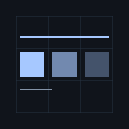

<div align="center">



# sd-widgets

**Панель управления Steam Deck и демон для компьютера**

[English](./README.md) · **Русский** · [Українська](./README.uk.md)

<br>

</div>

Дека превращается во второй экран, виртуальный геймпад, панель уведомлений и
пульт Home Assistant — и выглядит как жёсткая сеточная система с шагом 32 px, а
не как телефонное приложение.

- **Один репозиторий, два бинарника**: `sdw-deck` (на деке) и `sdw-daemon` (на ПК).
- **Grid**: ни одного скругления, тонкие линии, ячейки по 32 px и
  минимальный набор иконок **Material Symbols**.
  Тема grid вдохновлена [**Quadra**](https://quadrahq.org) — клиентом Roblox для
  Linux. Это очень красиво и аккуратно сделанная программа: жёсткие края, тихий
  интерфейс, всё точно по делу. Загляните, она того стоит.
- **Полная кастомизация**: CSS-темы, точный редактор всех 15 токенов палитры,
  плотность, сетка плиток, видимость страниц и плиток, звуки интерфейса и свои
  файлы на каждое событие.
- **Свои часы**: большая сетка, цифры, стрелки и минимум — с цветами, шрифтом,
  размером, анимацией, позицией, 12/24-часовым форматом, подписью, зарядом
  наушников и последним уведомлением. Цвета берутся из активной темы, поэтому
  каждый пресет, палитра и CSS-файл перекрашивают их; свои цвета — в одном
  переключателе.
- **Аддоны с обеих сторон**: декларативные пакеты добавляют темы, пресеты часов,
  плитки на главной, звуки и действия на компьютере без пересборки.
- **Пульт**: фиксированный набор действий питания (блокировка, сон,
  перезагрузка, выключение, гашение экрана) и список установленных приложений
  для запуска — демон запускает только то, что нашёл сам, и никогда командную
  строку с деки.
- **Bluetooth**: спаривание, подключение, доверие и удаление устройств на
  компьютере, с зарядом наушников из BlueZ и UPower.
- **Центр управления по свайпу вниз**: уведомления, громкость самой деки и
  яркость экрана в одной панели поверх любой страницы, плюс ручка сверху.
- **Звук с ПК на деку**: весь компьютер или выбранные приложения играют в
  динамики деки, с настраиваемым числом подтверждений «вы точно хотите?».
- **Самообновление из любого источника**: оба приложения проверяют новый релиз,
  показывают список изменений и скачивают подходящую сборку. Источник — настройка:
  встроенный `git.entitybtw.ru`, репозиторий на GitHub или свой инстанс
  Forgejo/Gitea, записанный веб-адресом репозитория.
- **Недостающие программы ставятся сами**: дека перечисляет внешние программы,
  которые запускает (звук, медиа, ввод, снимки), и ставит отсутствующие с паролем
  администратора, открывая read-only root SteamOS только на время установки.
- **Три языка и любой свой**: русский, украинский и английский встроены;
  языковой пакет в формате TOML в папке настроек добавляет любой другой, а
  шаблон со всеми строками приложения выгружается одной кнопкой.
- **Таймеры**: обратный отсчёт с пресетами и ±1 минутой, секундомер с кругами
  и помодоро с автоматическими фазами, сохранёнными длинами и звуком в конце.

> Название пишется строчными: `sd-widgets`.

## Что умеет

### На деке (`sdw-deck`)

| Страница | Что это |
| --- | --- |
| **Домой** | Сетка крупных плиток: геймпад, экран, уведомления, Home Assistant, бинды, пульт, Bluetooth, компьютеры. |
| **Компьютеры** | Поиск в локальной сети, подключение по паролю, переключение между ПК. |
| **Пульт** | Блокировка, сон, перезагрузка, выключение и гашение экрана ПК, запуск установленных приложений. |
| **Bluetooth** | Устройства компьютера: подключение, отключение, спаривание, доверие, удаление и заряд наушников. |
| **Геймпад** | Нарисованная Steam Deck со всеми органами, подсветка в реальном времени и редактор биндов: любой орган, жест или четверть тачпада. |
| **Экран** | Дополнительный монитор: запуск, бэкенд, позиция, разрешение, fps, качество; на деке только просмотр. |
| **Звук** | Звук компьютера или выбранных приложений в динамиках деки: источник, качество, громкость и подтверждения. Визуализатор в духе cava читает микс компьютера и полностью настраивается. |
| **Уведомления** | Зеркало уведомлений рабочего стола, счётчик непрочитанных; карточка уезжает вбок свайпом, а «прочитать все» снимает счётчики одним нажатием. |
| **Home Assistant** | Комнаты и зоны с виджетами света, штор, климата и медиа, а не стена из всех сущностей. Локальные сценарии ставят несколько устройств одним нажатием, а сцены, скрипты и автоматизации самого Home Assistant запускаются отсюда же. |
| **Бинды** | Кнопки, аккорды и свайпы, привязанные к действиям или командам ПК. |
| **Часы** | Полноэкранные часы в четырёх стилях, полностью настраиваемые и сохраняемые как пресет или аддон. |
| **Таймеры** | Обратный отсчёт, секундомер с кругами и помодоро с сохранёнными длинами, пресетами и звуком в конце. |
| **Аддоны** | Импорт, включение, настройка и удаление пакетов; свой вид или часы можно сохранить как аддон. |
| **Вид** | Пресеты, палитра, редактор CSS, сетка, плотность, док, стрелки, страницы, звуки. |
| **Настройки** | Имя устройства, язык и языковые пакеты, тема, масштаб, устройства ввода, трансляция экрана, обновления и их источник, компоненты деки. |

Свайп вниз от верхнего края (или нажатие на ручку) открывает **центр
управления**: свежие уведомления, громкость самой деки и яркость экрана поверх
любой открытой страницы.

Любая страница открывается **видимыми стрелками**, плавающим доком, свайпами
тремя пальцами, с клавиатуры или органами самой деки: левый стик и d-pad двигают
курсор, правый стик прокручивает, **A** нажимает, **B** возвращает назад,
**LB/RB** переключают страницы, **Y** открывает «Домой», **View** — настройки.
Страницу можно тянуть пальцем в любом месте, а горизонтальный свайп (или
быстрый бросок) переключает страницы: достаточно пятой части экрана. Во время
свайпа страница едет за пальцем, а после отпускания либо мягко возвращается, либо
доводит поворот до соседней страницы; стрелки сдвигают страницы так же, а док
сохраняет своё затухание. Страница отступает от стрелок, поэтому ни карточка, ни ползунок не уходят под них.

### На компьютере (`sdw-daemon`)

- **Виртуальные геймпады через VIIPER** — Xbox 360, DualShock 4, DualSense и
  универсальные пады, горячее подключение по USBIP. VIIPER ставится из GUI, а
  его релизы по умолчанию берутся с GitHub `Alia5/VIIPER` или с любого зеркала
  GitHub/Forgejo, указанного в карточке VIIPER.
- **Дополнительный монитор** — создаётся настоящий новый экран и стримится на деку:
  - Hyprland: headless-выход (`hyprctl output create headless`);
  - niri: настоящий виртуальный выход через **biri** (форк niri с
    `niri msg create-virtual-output`) — реальный второй экран, который рисует
    сам композитор: без VKMS и работает с NVIDIA. На стоковом niri — запасной
    путь через VKMS + `niri msg output` и одна кнопка в мастере, которая
    загружает модуль и оставляет его включённым после перезагрузки;
  - KDE: `krfb-virtualmonitor` и встроенный RFB-клиент;
  - X11 и Windows: захват `ffmpeg`;
  - виртуальные машины: тот же путь через VKMS выбирается автоматически, а
    мастер показывает готовность модуля, выхода и конфига;
  - запасной вариант: зеркало существующего выхода через `grim`/`spectacle`.
- **Автоматическая раскладка** — позиция справа/слева/сверху/снизу/авто
  применяется сразу и записывается в конфиг композитора
  (`~/.config/niri/config.kdl`, `~/.config/hypr/hyprland.conf`,
  `~/.config/sway/config`, настройки KDE, `xrandr`).
- **Зеркало уведомлений** — владеет шиной уведомлений и отдаёт поток на деку;
  нажатие на уведомление на деке запускает действие самого приложения на
  компьютере, так что чат, браузер или файловый менеджер открываются там, где
  им место. История хранится на диске, поэтому перезапуск демона больше не
  стирает непрочитанное.
- **Экран деки** — дека отдаёт свой экран, пока в демоне открыта страница
  **стим дек**: последний кадр, страница и список подключённых дек. Кадры —
  уменьшенные JPEG несколько раз в секунду и только пока на них смотрят, так
  что простаивающая дека ничего не тратит.
- **Home Assistant** — URL и долгоживущий токен на компьютере, сущности идут
  через демон. Дека может держать и несколько своих серверов, у каждого свой
  адрес и токен; на странице Home Assistant переключаются они и подключение
  компьютера. У лампочек есть яркость, цветовая температура и палитра, оттенки
  из которой можно сохранить на деке и использовать снова.
- **Управление ПК** — фиксированный набор действий питания (блокировка, сон,
  перезагрузка, выключение, гашение экрана) и список установленных приложений;
  демон запускает только то, что нашёл сам, а не команду с деки.
- **Bluetooth** — спаривание, подключение, доверие и удаление устройств на
  компьютере, с зарядом наушников из BlueZ и UPower.
- **Звук с ПК** — демон записывает общий выход или выбранные приложения и отдаёт
  сырой PCM на деку, где его играет `pw-play`/`paplay`. По умолчанию звук
  выключен, а дека может требовать любое число подтверждений перед запуском.
- **Всегда в фоне** — закрытие окна не останавливает демон: окно закрывается
  по-настоящему, даже там, где нет сворачивания, а API и связь с декой
  продолжают работать. Иконка в трее, `sdw-daemon --show` или повторный запуск
  открывают окно заново. `sdw-daemon --quit`, меню в трее или кнопка
  **остановить демон** в самом демоне завершают его по-настоящему.
- **Мастер настройки** — поля с паролем, проверка зависимостей, установка VIIPER
  и явная строка, которую нужно добавить в конфиг, если автопатч невозможен.

## Требования

**Дека**

- Linux (SteamOS, CachyOS handheld, любой дистрибутив), Wayland или X11.
- Членство в группе `input` для органов самой деки и жестов. Без него работают
  касания и экранный интерфейс, а на «Домой» показывается нужная команда.
- Сборка: Rust 1.88+.

**Компьютер**

- Linux или Windows.
- По желанию, в зависимости от функций:
  - VIIPER 0.6+ для виртуальных геймпадов (демон может установить его сам).
  - `usbip` для локального подключения VIIPER.
  - `hyprctl` / `niri` / `krfb-virtualmonitor` / `ffmpeg` / `grim` / `spectacle` /
    `xrandr`, в зависимости от бэкенда монитора.
  - `pw-play`, `paplay`, `aplay`, `ffplay` или `mpv` на деке для звуков интерфейса.

## Установка

### Одна команда

```bash
curl -fsSL https://git.entitybtw.ru/entitybtw/sd-widgets/raw/branch/main/packaging/install.sh | bash
```

Скрипт сам понимает, где запущен. На Steam Deck он ставит
`~/.local/bin/sdw-deck`, добавляет пункт меню и кладёт **sd-widgets** в
библиотеку Steam с обложкой, чтобы приложение запускалось из Game Mode. На
компьютере — ставит `~/.local/bin/sdw-daemon`, включает и запускает
пользовательскую службу systemd; откройте `http://<компьютер>:47830`,
завершите настройку и подключите деку.

Установка на деку заодно кладёт для ярлыка раскладку Steam Input
**sd-widgets** и делает её текущей: кнопки, стики, триггеры и d-pad остаются на
xinput, а оба тачпада намеренно не назначены, потому что sd-widgets читает их
сам. Steam держит библиотеку в памяти, поэтому скрипт один раз перезапускает
его, чтобы сохранить ярлык и раскладку.

Выбрать роль вручную можно, передав `deck` или `daemon` после `bash -s --`:

```bash
curl -fsSL https://git.entitybtw.ru/entitybtw/sd-widgets/raw/branch/main/packaging/install.sh | bash -s -- deck
```

Установщик принимает `--version V` для конкретного релиза, `--local FILE`
для уже скачанного AppImage, `--dir DIR` для другого префикса, а также
`--no-service`, `--no-steam`, `--no-layout`, `--no-steam-restart` и
`--steam-only`. Его можно запускать повторно: файлы и ярлык Steam обновятся,
второй записи не появится. Подробности — [`docs/INSTALL.md`](docs/INSTALL.md).

### Готовые сборки

- `sdw-deck-<версия>-x86_64.AppImage` — дека и Linux.
- `sdw-daemon-<версия>-windows-x86_64.zip` — Windows, портативно: распаковать и
  запустить.
- `sdw-daemon-<версия>-windows-x86_64-setup.exe` — Windows, необязательный
  установщик (собирается при наличии Inno Setup; основной формат — портативный zip).

### Из исходников

```bash
git clone https://git.entitybtw.ru/entitybtw/sd-widgets
cd sd-widgets
cargo build --release -p sdw-deck -p sdw-daemon
```

## Обновления

Оба приложения проверяют новый опубликованный релиз на
`https://git.entitybtw.ru/entitybtw/sd-widgets/releases` при запуске и каждые
шесть часов. В **Настройках → Обновления** видны версия, список изменений и кнопка
скачивания. На Linux скачанный AppImage заменяет запущенный файл, а рядом
появляется кнопка **перезапустить**: демон просит systemd-сервис поднять его
заново, а запущенный вручную — запускает сам себя. На Windows показывается путь к
скачанному файлу. Без окна:

```bash
sdw-daemon --check-updates
sdw-daemon --download-update
```

## Подключение

1. Запусти `sdw-daemon` на ПК. При первом запуске откроется мастер и покажет
   **пароль для подключения**.
2. На деке открой **Компьютеры → добавить компьютер**, выбери демон в списке или
   введи адрес.
3. Введи пароль один раз. Демон выдаст API-токен, дека сохранит его для этого ПК.
4. Переключай компьютеры из шапки или со страницы «Компьютеры».

Порты: `47830/tcp` (REST), `47831/udp` (ввод геймпада), `47832/udp` (обнаружение).
Все REST-запросы требуют токен.

## Дополнительный монитор

Демон создаёт монитор, который реально существует для системы, и стримит его на
деку в 1280×800 по умолчанию.

- Позиция выбирается в демоне: авто, справа, слева, сверху, снизу.
- Настраиваются бэкенд, размер, fps и качество JPEG.
- Раскладка применяется сразу и сохраняется в конфиг композитора.
- На niri с **biri** экран создаётся родной командой
  `niri msg create-virtual-output`: это настоящий второй выход, его рисует сам
  композитор, VKMS не нужен. На стоковом niri, на sway, в GNOME и в виртуальной
  машине используется выход VKMS, а кнопка **подготовить vkms** загружает модуль
  и пишет `modules-load.d`/`modprobe.d`. Мастер показывает готовность: модуль в
  ядре, модуль загружен, выход найден, путь к конфигу.
- Если автопатч невозможен, мастер показывает точную строку для конфига.

Подробности: [`docs/MONITOR.md`](docs/MONITOR.md).

## Темы, вёрстка и звуки

Страница **Вид** — это вся дизайн-система:

- пять пресетов: Grid, Monochrome, Nord, Gruvbox, Terminal;
- точные цвета всех 15 токенов обеих палитр: `bg`, `bg2`, `card`, `well`,
  `ink`, `strong`, `muted`, `faint`, `line`, `line-strong`, `accent`,
  `accent-soft`, `good`, `warn`, `bad`;
- живой редактор CSS: подхватывается любое объявление `--name: value;`;
- сетка: вкл/выкл, шаг и яркость линий;
- плотность, масштаб шрифта, высота плиток и число колонок;
- стрелки, док, подписи, глифы и анимации;
- какие страницы показывать в доке и какие плитки — на главной;
- три синтезированных набора звуков (`grid`, `soft`, `chip`), громкость и свой
  WAV-файл на каждое событие.

Переменные и модель темы описаны в [`docs/THEMES.md`](docs/THEMES.md).

## Часы

Страница «Часы» рисует полноэкранные часы, а настройки держит рядом:

- четыре циферблата: **сетка** (большое время на сетке приложения), **цифры**,
  **стрелки** и **минимум**;
- цвет акцента и два цвета фона, выбор шрифта, размер, анимация (`drift`,
  `pulse`, `off`), позиция на экране, подпись и один из двенадцати значков
  Material (часы, солнце, луна, звезда, музыка, игры и другие);
- секунды, дата, день недели, батарея деки, заряд наушников и последнее
  уведомление по желанию;
- 12/24-часовой формат и полноэкранный режим, который закрывается касанием
  или Escape;
- пресеты часов из аддонов появляются кнопками вверху страницы.

Циферблат — конструктор: каждый переключатель и ползунок виден сразу.
**Сохранить часы** оставляет текущий вид аддоном, а **экспорт часов** пишет
готовый пакет `.sdwaddon` в папку загрузок — или в
`~/.local/share/sd-widgets/exports`, если загрузок нет — чтобы перенести часы
на другую деку, отдать кому-то или положить в магазин. Темы экспортируются так
же со страницы часов и с каждой карточки на странице аддонов.

## Звук с ПК

Страница **Звук** превращает деку в колонки для компьютера:

- **весь компьютер** или **выбранные приложения** — можно несколько сразу:
  на PipeWire каждое приложение пишется отдельно и смешивается в демоне; на
  чистом PulseAudio используется временный выход, а при остановке звук
  возвращается на прежнее устройство;
- 44.1 или 48 кгц, стерео PCM по защищённому соединению в локальной сети, играет
  `pw-play` (или `paplay`/`aplay`);
- список источников, объём переданного, время и понятные ошибки с обеих сторон;
- настройка **подтверждений** (0–3): столько раз дека спросит «вы точно хотите
  перевести звук?» перед запуском.

**Визуализатор** рисует звук полосками в шапке, в центре управления и на часах,
а по желанию — и на полноэкранных часах. С включённым **звуком с пк** демон по
запросу читает монитор системного выхода компьютера, поэтому полоски двигаются,
даже когда музыка играет в его собственных колонках. Вид (полоски, точки,
волна), цвет, зеркало, пики, чувствительность, число полосок и размер — всё
настраивается; настраивается и место: девять якорей на циферблате с точными
сдвигами и своя сторона в шапке. Кадров в секунду тоже настройка — от 10 до 60.
Вид по умолчанию повторяет cava, и одна кнопка возвращает его после
экспериментов.

В демоне звук выключен, пока не включить **Звук → разрешить звук**; запуск с деки
можно запретить, оставив его только окну компьютера. Подробности —
[`docs/AUDIO.md`](docs/AUDIO.md).

## Аддоны

Аддон — это папка с `addon.json` и файлами, один файл `.css`, `.json` или
`.sdwaddon`, либо ссылка на любой из них. Архивы распаковывают сами бинарники,
поэтому `unzip` в системе не нужен. Один пакет может расширять обе стороны:

- **тему** (CSS и дополнительный CSS);
- **пресет часов** (JSON);
- **плитки** на главной деки;
- **звуки**, заменяющие встроенные файлы;
- **действия демона**, доступные деке как `addon:<id>:<action>` и запускаемые
  из деки и из окна демона;
- типизированные **настройки** (`text`, `number`, `bool`, `color`, `choice`),
  которые рисуют оба приложения, с подстановкой `{key}` в каждое действие.

### Магазин

**Аддоны → магазин** принимает ссылку на репозиторий и показывает его пакеты
плитками с кнопкой **установить**. Магазин — это статический JSON-каталог
(`repo.json`, `index.json`, `api/v1/addons.json` или `addons.json`) и пакеты, на
которые он ссылается; относительные ссылки считаются от базы репозитория, а
необязательный `sha256` проверяется до установки. Дека ставит пакет себе и
просит спаренный компьютер поставить ту же ссылку, поэтому пакет с действиями
демона работает на обеих сторонах после одного нажатия.

### HTTP-действия

Действие аддона может вызвать любой API:

```json
{ "http": { "method": "POST", "url": "{base}/hooks/{token}",
            "body": "{\"entity\":\"{settings.entity}\"}" } }
```

Запрос выполняется в фоне на обеих сторонах, с таймаутом 20 с, а ответ
становится коротким уведомлением или строкой лога. Принимаются только адреса
`http`/`https`.

Установка — **Аддоны → импорт** на деке или в окне демона. Формат, все поля,
схема каталога и модель безопасности описаны в [`docs/ADDONS.md`](docs/ADDONS.md).

## API

Дека и демон общаются JSON по HTTP. Эндпоинты — в [`docs/API.md`](docs/API.md).

Удалённые команды ПК — **фиксированный белый список** (`lock`, `sleep`,
`reboot`, `shutdown`, `screen_off`, громкость, мультимедиа, открытие URL) плюс
объявленный список установленных приложений. Произвольного shell-эндпоинта нет.

## Структура

```
crates/sdw-core      общая модель, REST-клиент, авторизация, обнаружение, UDP, i18n
crates/sdw-deck      приложение деки (egui)
crates/sdw-daemon    демон ПК, сервер и GUI (egui)
vendor/viiper-client MIT-клиент VIIPER
assets               шрифты и иконки
packaging            install.sh, desktop-файлы, systemd-юнит, скрипты AppImage / Windows
docs                 архитектура, API, темы, монитор, аддоны, звук
```

## Безопасность

- Пароли хранятся как SHA-256 с солью; API-токен случайный для каждого демона.
- REST-сервер слушает локальную сеть и требует токен на каждом маршруте.
- Дополнительный монитор отдаёт только созданный им выход (или выбранный в режиме
  зеркала).
- Из недоверенного ввода ничего не исполняется: удалённые действия — это enum.
- Действия аддонов запускаются только из локально установленных и включённых
  пакетов; выключенный аддон нельзя вызвать через API.

## Лицензия

MIT для этого репозитория. Вендоренный **клиент** VIIPER — MIT. Иконки Material
Symbols и шрифты Archivo / JetBrains Mono / Noto Emoji сохраняют свои лицензии
(Apache-2.0 и OFL) и лежат в `assets/`. **Сервер** VIIPER —
отдельный проект под GPL-3.0 и **не** входит в поставку; демон может установить его
из релизов, если ты попросишь.
