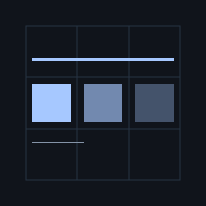

<div align="center">



# sd-widgets

**Панель керування Steam Deck і демон для комп'ютера**

[English](./README.md) · [Русский](./README.ru.md) · **Українська**

<br>

</div>

Дека перетворюється на другий екран, віртуальний геймпад, панель сповіщень і
пульт Home Assistant — і виглядає як жорстка сіточна система з кроком 32 px, а
не як телефонний застосунок.

- **Один репозиторій, два бінарники**: `sdw-deck` (на деці) і `sdw-daemon` (на комп'ютері).
- **Grid**: жодного заокруглення, тонкі лінії, комірки по 32 px і
  мінімальний набір іконок **Material Symbols**.
  Тема grid натхненна [**Quadra**](https://quadrahq.org) — клієнтом Roblox для
  Linux. Це дуже гарно й акуратно зроблена програма: жорсткі краї, тихий
  інтерфейс, усе точно по справі. Загляньте, вона того варта.
- **Повна кастомізація**: CSS-теми, точний редактор усіх 15 токенів палітри,
  щільність, сітка плиток, видимість сторінок і плиток, звуки інтерфейсу та
  власні файли на кожну подію.
- **Свій годинник**: велика сітка, цифри, стрілки й мінімум — з кольорами,
  шрифтом, розміром, анімацією, позицією, 12/24-годинним форматом, підписом,
  зарядом навушників і останнім сповіщенням. Він бере кольори з активної теми,
  тож кожен пресет, палітра й CSS-файл перефарбовують його; власні кольори — за
  один перемикач.
- **Аддони з обох боків**: декларативні пакети додають теми, пресети годинника,
  плитки на головній, звуки й дії на комп'ютері без перезбирання.
- **Пульт керування**: фіксований набір дій живлення (блокування, сон,
  перезавантаження, вимкнення, гасіння екрана) і список встановлених
  застосунків для запуску — демон запускає лише ті, що знайшов сам, і ніколи
  командний рядок з деки.
- **Bluetooth**: спарювання, підключення, довіра й видалення пристроїв на
  комп'ютері, із зарядом навушників з BlueZ і UPower.
- **Центр керування свайпом униз**: сповіщення, гучність самої деки й
  яскравість екрана в одній панелі поверх будь-якої сторінки, плюс ручка зверху.
- **Звук з ПК на деку**: увесь комп'ютер або вибрані застосунки грають у
  динаміки деки, з налаштовуваною кількістю підтверджень «ви точно хочете?».
- **Самооновлення з будь-якого джерела**: обидва застосунки перевіряють новий
  реліз, показують список змін і завантажують відповідну збірку. Джерело —
  налаштування: вбудований `git.entitybtw.ru`, репозиторій на GitHub або власний
  інстанс Forgejo/Gitea, записаний веб-адресою репозиторію.
- **Відсутні програми ставляться самі**: дека перелічує зовнішні програми, які
  запускає (звук, медіа, введення, знімки), і ставить відсутні з паролем
  адміністратора, відкриваючи read-only root SteamOS лише на час встановлення.
- **Три мови й будь-яка своя**: українська, російська й англійська вбудовані;
  мовний пакет у форматі TOML у теці налаштувань додає будь-яку іншу, а шаблон з
  усіма рядками застосунку вивантажується однією кнопкою.
- **Таймери**: зворотний відлік з пресетами й ±1 хвилиною, секундомір з колами й
  помодоро з автоматичними фазами, збереженими довжинами й звуком у кінці.

> Назва пишеться малими літерами: `sd-widgets`.

## Що вміє

### На деці (`sdw-deck`)

| Сторінка | Що це |
| --- | --- |
| **Додому** | Сітка великих плиток: геймпад, екран, сповіщення, Home Assistant, бінди, пульт, Bluetooth, комп'ютери. |
| **Комп'ютери** | Пошук у локальній мережі, підключення за паролем, перемикання між ПК. |
| **Пульт** | Блокування, сон, перезавантаження, вимкнення й гасіння екрана ПК, запуск встановлених застосунків. |
| **Bluetooth** | Пристрої комп'ютера: підключення, відключення, спарювання, довіра, видалення й заряд навушників. |
| **Геймпад** | Намальована Steam Deck з усіма органами, підсвічування в реальному часі й редактор біндів: будь-який орган, жест або чверть тачпада. |
| **Екран** | Додатковий монітор: запуск, бекенд, позиція, роздільність, fps, якість; на деці лише перегляд. |
| **Звук** | Звук комп'ютера або вибраних застосунків у динаміках деки: джерело, якість, гучність і підтвердження. Візуалізатор у дусі cava читає мікс комп'ютера й повністю налаштовується. |
| **Сповіщення** | Дзеркало сповіщень робочого столу, лічильник непрочитаних; картка від'їжджає вбік свайпом, а «прочитати все» знімає лічильники одним натисканням. |
| **Home Assistant** | Кімнати й зони з віджетами світла, штор, клімату й медіа, а не стіна з усіх сутностей. Локальні сценарії ставлять кілька пристроїв одним натисканням, а сцени, скрипти й автоматизації самого Home Assistant запускаються звідси ж. |
| **Бінди** | Кнопки, акорди й свайпи, прив'язані до дій або команд ПК. |
| **Годинник** | Повноекранний годинник у чотирьох стилях, повністю налаштовуваний і збережуваний як пресет або аддон. |
| **Таймери** | Зворотний відлік, секундомір з колами й помодоро зі збереженими довжинами, пресетами й звуком у кінці. |
| **Аддони** | Імпорт, увімкнення, налаштування й видалення пакетів; свій вигляд або годинник можна зберегти як аддон. |
| **Вигляд** | Пресети, палітра, редактор CSS, сітка, щільність, док, стрілки, сторінки, звуки. |
| **Налаштування** | Ім'я пристрою, мова й мовні пакети, тема, масштаб, пристрої введення, трансляція екрана, оновлення та їхнє джерело, компоненти деки. |

Свайп униз від верхнього краю (або натискання на ручку) відкриває **центр
керування**: свіжі сповіщення, гучність самої деки й яскравість екрана поверх
будь-якої відкритої сторінки.

Будь-яку сторінку відкривають **видимі стрілки**, плаваючий док, свайпи трьома
пальцями, з клавіатури або органи самої деки: лівий стік і d-pad рухають курсор,
правий стік прокручує, **A** натискає, **B** повертає назад, **LB/RB**
перемикають сторінки, **Y** відкриває «Додому», **View** — налаштування.
Сторінку можна тягнути пальцем будь-де, а горизонтальний свайп (або швидкий
кидок) перемикає сторінки: достатньо п'ятої частини екрана. Під час свайпу
сторінка їде за пальцем, а після відпускання або м'яко повертається, або доводить
поворот до сусідньої сторінки; стрілки зсувають сторінки так само, а док зберігає
своє згасання. Сторінка відступає від стрілок, тому жодна картка, повзунок чи
кнопка не опиняються під ними.

### На комп'ютері (`sdw-daemon`)

- **Віртуальні геймпади через VIIPER** — Xbox 360, DualShock 4, DualSense і
  універсальні пади, гаряче підключення через USBIP. VIIPER ставиться з GUI, а
  його релізи за замовчуванням беруться з GitHub `Alia5/VIIPER` або з будь-якого
  дзеркала GitHub/Forgejo, вказаного в картці VIIPER.
- **Додатковий монітор** — створюється справжній новий екран і стримиться на деку:
  - Hyprland: headless-вихід (`hyprctl output create headless`).
  - niri: справжній віртуальний вихід через **biri** (форк niri з
    `niri msg create-virtual-output`) — реальний другий екран, який малює сам
    композитор: без VKMS і працює з NVIDIA. На стоковому niri — запасний шлях
    через VKMS + `niri msg output` і одна кнопка в майстрі, яка завантажує модуль
    і лишає його ввімкненим після перезавантаження.
  - KDE: `krfb-virtualmonitor` і вбудований RFB-клієнт.
  - X11 і Windows: захоплення `ffmpeg`.
  - віртуальні машини: той самий шлях через VKMS вибирається автоматично, а
    майстер показує готовність модуля, виходу й конфігу.
  - запасний варіант: дзеркало наявного виходу через `grim`/`spectacle`.
- **Автоматичне розташування** — позиція праворуч/ліворуч/зверху/знизу/авто
  застосовується одразу й записується в конфіг композитора
  (`~/.config/niri/config.kdl`, `~/.config/hypr/hyprland.conf`,
  `~/.config/sway/config`, налаштування KDE, `xrandr`).
- **Дзеркало сповіщень** — володіє шиною сповіщень і віддає потік на деку;
  натискання сповіщення на деці запускає дію самого застосунку на комп'ютері,
  тож чат, браузер або файловий менеджер відкриваються там, де їм місце. Історія
  зберігається на диску, тож перезапуск демона більше не стирає непрочитане.
- **Екран деки** — дека віддає свій екран, поки в демоні відкрита сторінка
  **стім дек**: останній кадр, сторінку й список підключених дек. Кадри —
  зменшені JPEG кілька разів на секунду і лише поки на них дивляться, тож
  простоююча дека нічого не витрачає.
- **Менеджер Bluetooth** — сканує, спарює, підключає, додає в довірені й забуває
  пристрої через BlueZ; заряд навушників і вкладних навушників береться з BlueZ
  або з UPower, коли пристрій його не повідомляє.
- **Home Assistant** — URL + довготривалий токен на комп'ютері, сутності йдуть
  через демон. Дека може тримати й кілька своїх серверів, у кожного своя адреса й
  токен; на сторінці Home Assistant перемикаються вони й підключення комп'ютера.
  У лампочок є яскравість, колірна температура й палітра, відтінки з якої можна
  зберегти на деці й використовувати знову.
- **Звук з ПК** — демон записує загальний вихід або вибрані застосунки й віддає
  сирий PCM на деку, де його грає `pw-play`/`paplay`. За замовчуванням звук
  вимкнений, а дека може вимагати будь-яку кількість підтверджень перед запуском.
- **Завжди у фоні** — закриття вікна не зупиняє демон: вікно зникає
  по-справжньому, навіть там, де немає згортання, а API і зв'язок з декою
  продовжують працювати. Іконка в треї, `sdw-daemon --show` або повторний запуск
  відкривають вікно заново. `sdw-daemon --quit`, меню в треї або кнопка
  **зупинити демон** у самому демоні завершують його по-справжньому.
- **Майстер налаштування** — поля з паролем, перевірка залежностей, кнопки
  встановлення VIIPER та інших і явний рядок, який треба додати в конфіг, якщо
  автопатч неможливий.

## Вимоги

**Дека**

- Linux (SteamOS, CachyOS handheld, будь-який дистрибутив), Wayland або X11.
- Членство в групі `input` для органів самої деки й жестів. Без нього працюють
  дотики й екранний інтерфейс, а на «Додому» показується потрібна команда.
- Збирання: Rust 1.88+.

**Комп'ютер**

- Linux або Windows.
- За бажанням, залежно від функцій:
  - VIIPER 0.6+ для віртуальних геймпадів (демон може його встановити).
  - `usbip` для локального підключення VIIPER.
  - `hyprctl` / `niri` / `krfb-virtualmonitor` / `ffmpeg` / `grim` / `spectacle` /
    `xrandr`, залежно від бекенду монітора.
  - `pw-play`, `paplay`, `aplay`, `ffplay` або `mpv` на деці для звуків інтерфейсу.

## Встановлення

### Одна команда

```bash
curl -fsSL https://git.entitybtw.ru/entitybtw/sd-widgets/raw/branch/main/packaging/install.sh | bash
```

Скрипт сам визначає, де запущений. На Steam Deck він ставить
`~/.local/bin/sdw-deck`, додає пункт меню й кладе **sd-widgets** у бібліотеку
Steam з обкладинкою, щоб застосунок запускався з Game Mode. На комп'ютері —
ставить `~/.local/bin/sdw-daemon`, вмикає й запускає користувацьку службу
systemd; відкрийте `http://<комп'ютер>:47830`, завершіть налаштування й
підключіть деку.

Встановлення на деку заразом кладе для ярлика розкладку Steam Input
**sd-widgets** і робить її поточною: кнопки, стіки, тригери й d-pad лишаються на
xinput, а обидва тачпади навмисно не призначені, бо sd-widgets читає їх сам.
Steam тримає бібліотеку в пам'яті, тому скрипт один раз перезапускає його, щоб
зберегти ярлик і розкладку.

Вибрати роль вручну можна, передавши `deck` або `daemon` після `bash -s --`:

```bash
curl -fsSL https://git.entitybtw.ru/entitybtw/sd-widgets/raw/branch/main/packaging/install.sh | bash -s -- deck
```

Інсталятор приймає `--version V` для конкретного релізу, `--local FILE` для
вже завантаженого AppImage, `--dir DIR` для іншого префікса, а також
`--no-service`, `--no-steam`, `--no-layout`, `--no-steam-restart` і
`--steam-only`. Його можна запускати повторно: файли й наявний ярлик Steam
оновляться, другого запису не з'явиться. Подробиці —
[`docs/INSTALL.md`](docs/INSTALL.md).

### Готові збірки

Заберіть артефакти зі сторінки релізів:

- `sdw-deck-<версія>-x86_64.AppImage` — дека й Linux.
- `sdw-daemon-<версія>-windows-x86_64.zip` — Windows, портативно: розпакувати й
  запустити.
- `sdw-daemon-<версія>-windows-x86_64-setup.exe` — Windows, необов'язковий
  інсталятор (збирається за наявності Inno Setup; основний формат — портативний zip).

### З джерел

```bash
git clone https://git.entitybtw.ru/entitybtw/sd-widgets
cd sd-widgets
cargo build --release -p sdw-deck -p sdw-daemon
```

Бінарники з'являться в `target/release/`.

## Оновлення

Обидва застосунки перевіряють новий опублікований реліз на
`https://git.entitybtw.ru/entitybtw/sd-widgets/releases` під час запуску й кожні
шість годин. **Налаштування → Оновлення** показує версію, список змін і кнопку
завантаження. На Linux завантажений AppImage замінює запущений файл, а поруч
з'являється кнопка **перезапустити**: демон просить свою службу systemd підняти
його заново, а запущений вручну — запускає сам себе. На Windows показується
шлях до завантаженого файлу. Без вікна можна зробити те саме:

```bash
sdw-daemon --check-updates
sdw-daemon --download-update
```

## Підключення

1. Запусти `sdw-daemon` на комп'ютері. При першому запуску відкриється майстер і
   покаже **пароль для підключення**.
2. На деці відкрий **Комп'ютери → додати комп'ютер**, вибери демон у списку або
   введи адресу.
3. Введи пароль один раз. Демон видасть API-токен, дека збереже його для цього
   комп'ютера й більше не потребуватиме пароля.
4. Перемикай комп'ютери будь-коли з шапки або зі сторінки «Комп'ютери».

Демон слухає `47830/tcp` (REST), `47831/udp` (введення геймпада) і `47832/udp`
(виявлення в локальній мережі). Усі REST-запити вимагають токен.

## Додатковий монітор

Демон створює монітор, який реально існує для операційної системи, і стримить
його на деку в 1280×800 за замовчуванням.

- Позиція вибирається в демоні: авто, праворуч, ліворуч, зверху, знизу.
- Налаштовуються бекенд, розмір, fps і якість JPEG.
- Розкладка застосовується одразу й зберігається в конфіг композитора.
- На niri з **biri** екран створюється рідною командою
  `niri msg create-virtual-output`: це справжній другий вихід, його малює сам
  композитор, VKMS не потрібен. На стоковому niri, на sway, у GNOME і у
  віртуальній машині використовується вихід VKMS, а кнопка **підготувати vkms**
  завантажує модуль і пише `modules-load.d`/`modprobe.d`. Майстер показує
  готовність: модуль у ядрі, модуль завантажено, вихід знайдено, шлях до конфігу.
- Якщо автопатч неможливий, майстер показує точний рядок для конфігу.

Подробиці: [`docs/MONITOR.md`](docs/MONITOR.md).

## Теми, верстка й звуки

Сторінка **Вигляд** — це вся дизайн-система:

- п'ять пресетів: Grid, Monochrome, Nord, Gruvbox, Terminal;
- точні кольори всіх 15 токенів обох палітр: `bg`, `bg2`, `card`, `well`, `ink`,
  `strong`, `muted`, `faint`, `line`, `line-strong`, `accent`, `accent-soft`,
  `good`, `warn`, `bad`;
- живий редактор CSS: підхоплюється будь-яке оголошення `--name: value;`;
- сітка: увімк/вимк, крок і яскравість ліній;
- щільність, масштаб шрифту, висота плиток і кількість колонок;
- стрілки, док, підписи, гліфи й анімації;
- які сторінки показувати в доці й які плитки — на головній;
- три синтезовані набори звуків (`grid`, `soft`, `chip`), гучність і власний
  WAV-файл на кожну подію.

Змінні та модель теми описані в [`docs/THEMES.md`](docs/THEMES.md).

## Годинник

Сторінка «Годинник» малює повноекранний годинник, а налаштування тримає поруч:

- чотири циферблати: **сітка** (великий час на сітці застосунку), **цифри**,
  **стрілки** і **мінімум**;
- колір акценту й два кольори фону, вибір шрифту, розмір, анімація (`drift`,
  `pulse`, `off`), позиція на екрані, підпис і один із дванадцяти значків
  Material (годинник, сонце, місяць, зірка, музика, ігри та інші);
- секунди, дата, день тижня, батарея деки, заряд навушників і останнє
  сповіщення за бажанням;
- 12/24-годинний формат і повноекранний режим, який закривається дотиком або
  Escape;
- пресети годинника з аддонів з'являються кнопками вгорі сторінки.

Циферблат — конструктор: кожен перемикач і повзунок видно одразу. **Зберегти
годинник** лишає поточний вигляд аддоном, а **експорт годинника** пише готовий
пакет `.sdwaddon` у теку завантажень — або в
`~/.local/share/sd-widgets/exports`, якщо завантажень немає — щоб перенести
годинник на іншу деку, віддати комусь або покласти в магазин. Теми експортуються
так само зі сторінки годинника й з кожної картки на сторінці аддонів.

## Звук з ПК

Сторінка **Звук** перетворює деку на колонки для комп'ютера:

- **увесь комп'ютер** або **вибрані застосунки** — можна кілька одразу: на
  PipeWire кожен застосунок пишеться окремо й змішується в демоні; на чистому
  PulseAudio використовується тимчасовий вихід, а при зупинці звук повертається
  на попередній пристрій;
- 44.1 або 48 кГц, стерео PCM по захищеному з'єднанню в локальній мережі, грає
  `pw-play` (або `paplay`/`aplay`);
- список джерел, обсяг переданого, час і зрозумілі помилки з обох боків;
- налаштування **підтверджень** (0–3): стільки разів дека спитає «ви точно хочете
  перевести звук?» перед запуском.

**Візуалізатор** малює звук смужками в шапці, в центрі керування й на годиннику,
а за бажанням — і на повноекранному годиннику. З увімкненим **звуком з пк** демон
на запит читає монітор системного виходу комп'ютера, тож смужки рухаються, навіть
коли музика грає в його власних колонках. Вигляд (смужки, точки, хвиля), колір,
дзеркало, піки, чутливість, кількість смужок і розмір — усе налаштовується;
налаштовується й місце: дев'ять якорів на циферблаті з точними зсувами й свій бік
у шапці. Кадрів за секунду теж налаштування — від 10 до 60. Вигляд за
замовчуванням повторює cava, і одна кнопка повертає його після експериментів.

У демоні звук вимкнений, поки не увімкнути **Звук → дозволити звук**; запуск з
деки можна заборонити, лишивши його тільки вікну комп'ютера. Подробиці —
[`docs/AUDIO.md`](docs/AUDIO.md).

## Аддони

Аддон — це тека з `addon.json` і файлами, один файл `.css`, `.json` або
`.sdwaddon`, або посилання на будь-який із них. Архіви розпаковують самі
бінарники, тож `unzip` у системі не потрібен. Один пакет може розширювати
обидва боки:

- **тему** (CSS і додатковий CSS);
- **пресет годинника** (JSON);
- **плитки** на головній деки;
- **звуки**, що замінюють вбудовані файли;
- **дії демона**, доступні деці як `addon:<id>:<action>` і запускані з деки та з
  вікна демона;
- типізовані **налаштування** (`text`, `number`, `bool`, `color`, `choice`), які
  малюють обидва застосунки, з підстановкою `{key}` у кожну дію під час запуску.

### Магазин

**Аддони → магазин** приймає посилання на репозиторій і показує його пакети
плитками з кнопкою **встановити**. Магазин — це статичний JSON-каталог
(`repo.json`, `index.json`, `api/v1/addons.json` або `addons.json`) і пакети, на
які він посилається; відносні посилання рахуються від бази репозиторію, а
необов'язковий `sha256` перевіряється до встановлення. Дека ставить пакет собі й
просить спарений комп'ютер поставити те саме посилання, тож пакет з діями демона
працює з обох боків після одного натискання.

### HTTP-дії

Дія аддона може викликати будь-який API:

```json
{ "http": { "method": "POST", "url": "{base}/hooks/{token}",
            "body": "{\"entity\":\"{settings.entity}\"}" } }
```

Запит виконується у фоні з обох боків, з таймаутом 20 с, а відповідь стає
коротким сповіщенням або рядком логу. Приймаються лише адреси `http`/`https`.

Встановлення — **Аддони → імпорт** на деці або у вікні демона. Формат, усі поля,
схема каталогу й модель безпеки описані в [`docs/ADDONS.md`](docs/ADDONS.md).

## API

Дека й демон спілкуються JSON по HTTP. Ендпоінти — у [`docs/API.md`](docs/API.md):
підключення, стан, геймпад, сповіщення, Home Assistant, монітор, віддалені
команди й виявлення.

Віддалені команди ПК — **фіксований білий список** (`lock`, `sleep`, `reboot`,
`shutdown`, `screen_off`, гучність, медіа-клавіші, відкриття URL) плюс оголошений
список встановлених застосунків. Довільного shell-ендпоінта немає.

## Структура

```
crates/sdw-core      спільна модель, REST-клієнт, авторизація, виявлення, UDP, i18n
crates/sdw-deck      застосунок деки (egui)
crates/sdw-daemon    демон ПК, сервер і GUI (egui)
vendor/viiper-client MIT-клієнт VIIPER
assets               шрифти та іконки
packaging            install.sh, desktop-файли, systemd-юніт, скрипти AppImage / Windows
docs                 архітектура, API, теми, монітор, аддони, звук
```

## Безпека

- Паролі зберігаються як SHA-256 із сіллю; API-токен випадковий для кожного
  демона й кожного підключення.
- REST-сервер слухає локальну мережу й вимагає токен на кожному маршруті.
- Додатковий монітор віддає лише створений ним вихід (або вибраний у режимі
  дзеркала).
- З недовіреного введення нічого не виконується: віддалені дії — це enum.
- Дії аддонів запускаються лише з локально встановлених і ввімкнених пакетів;
  вимкнений аддон не можна викликати через API.

## Ліцензія

MIT для цього репозиторію. Вендорений **клієнт** VIIPER — MIT. Іконки Material
Symbols і шрифти Archivo / JetBrains Mono / Noto Emoji зберігають свої ліцензії
(Apache-2.0 і OFL) і лежать в `assets/`. **Сервер** VIIPER — окремий проєкт під
GPL-3.0 і **не** входить у поставку; демон може встановити його з власних
релізів, якщо ти попросиш.
